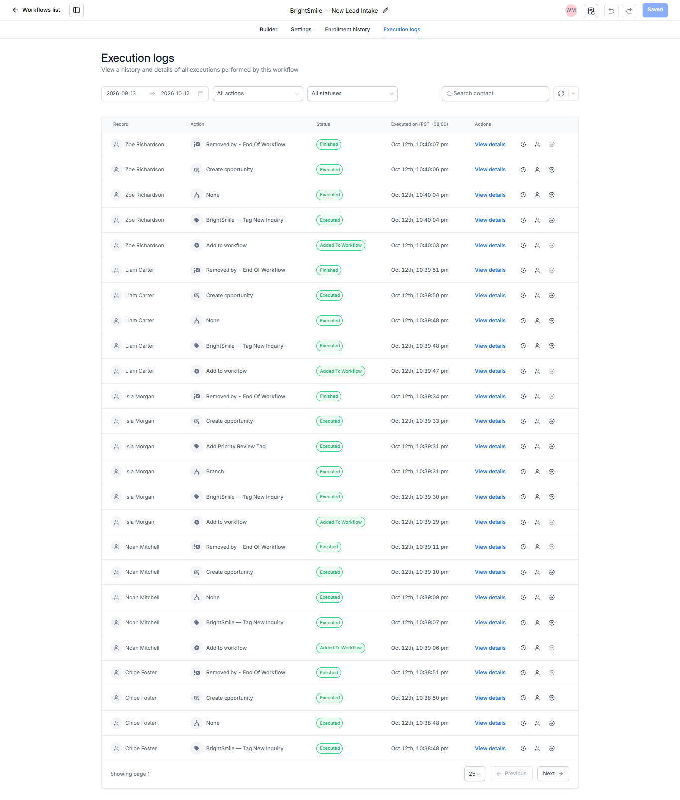
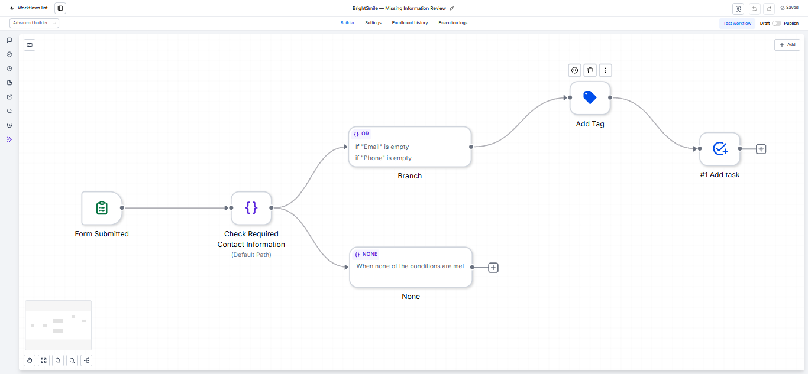
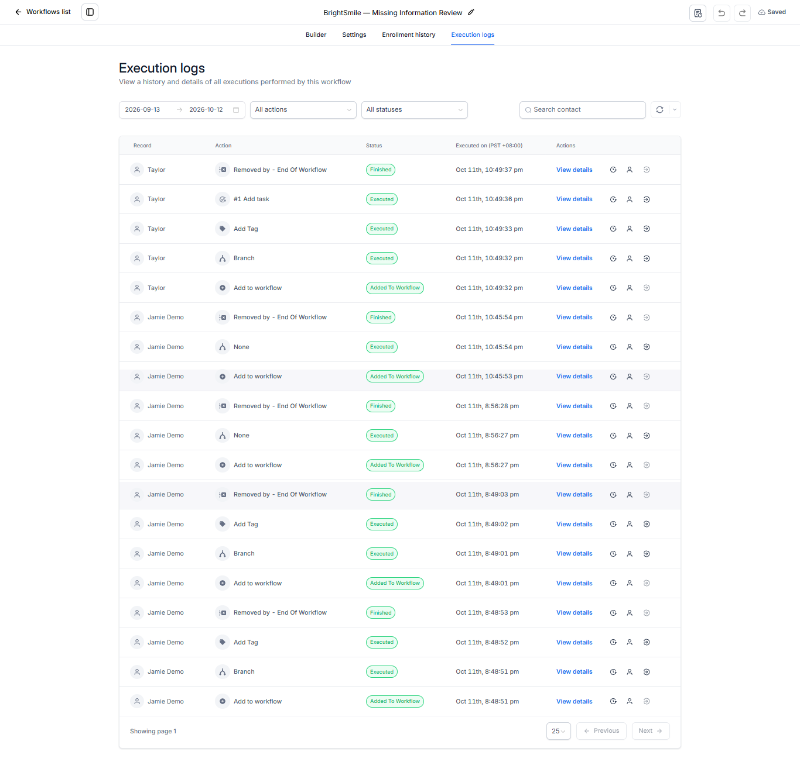
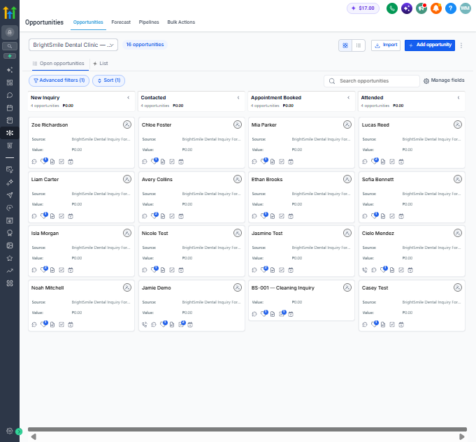
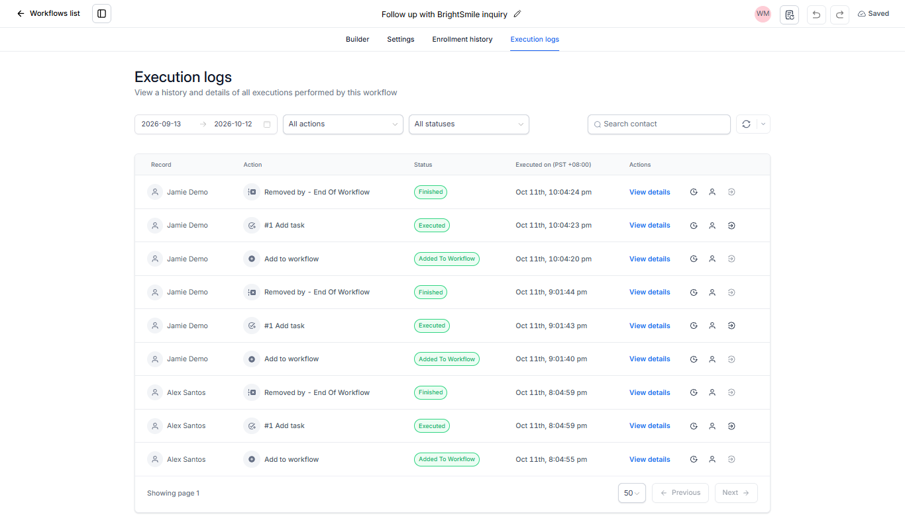

# BrightSmile Dental Clinic — CRM & Workflow Automation Demo

A CRM and workflow automation portfolio project built using **GoHighLevel** and **Google Sheets**. This fictional dental clinic demonstrates automated lead intake, conditional inquiry classification, priority tagging, opportunity management, incomplete-contact handling, and follow-up task configuration.

> **Project type:** Portfolio demonstration  
> **Business:** Fictional dental clinic  
> **CRM and automation:** GoHighLevel  
> **Test documentation:** Google Sheets  
> **Data:** Fictional test records

---

## Project Overview

Dental clinics may receive inquiries with different service interests, incomplete contact information, and varying follow-up needs. Without structured workflows, these inquiries can be difficult to organize and prioritize.

BrightSmile demonstrates how CRM automation can organize incoming inquiries, classify selected service requests, identify incomplete records, and create opportunities in a visual pipeline.

The project focuses on workflow design, conditional logic, testing, execution-log analysis, and clear documentation of limitations.

## Project Objectives

- Organize new inquiries through a CRM form and pipeline.
- Apply tags to identify new and priority inquiries.
- Use conditional branches to classify inquiry types.
- Flag contacts with missing email addresses or phone numbers.
- Create tasks for manual review and follow-up.
- Verify workflow behavior using execution logs and fictional test contacts.
- Document tested behavior and known limitations accurately.

## Tools Used

| Tool | Purpose |
|---|---|
| GoHighLevel | CRM, forms, workflow automation, contact tags, tasks, opportunities |
| Google Sheets | Test data, workflow logic, test cases, and documentation |

## 1. New Lead Intake and Priority Classification

**Trigger:** Form submitted — BrightSmile Dental Inquiry Form

The workflow applies the `brightsmile-new-inquiry` tag and evaluates the contact's selected inquiry type.

- **Braces Consultation:** Applies the `brightsmile-priority-review` tag and proceeds to opportunity creation.
- **Other inquiry types:** Follow the default branch and proceed to opportunity creation without the priority tag.

Duplicate-opportunity prevention is enabled to reduce duplicate open opportunities for the same contact.

### Workflow builder

### Execution evidence

The Jasmine Test execution log shows the classification branch, priority-tag action, and opportunity-creation action executed successfully.

## 2. Missing Information Review

**Trigger:** Form submitted — BrightSmile Dental Inquiry Form

This workflow checks whether the email address or phone number is empty.

- **If email or phone is missing:** Applies the `brightsmile-missing-info` tag and creates a review task.
- **If neither field is missing:** Follows the default branch without applying the missing-information tag.

The review task instructs the assigned user to inspect the inquiry, identify missing details, and update the contact record only when information can be verified.

### Workflow builder

### Execution evidence

Workflow test logs show the incomplete-information branch, tag action, and task action executing for a test contact. A separate workflow test also confirmed that a contact with both email and phone populated followed the default branch.

**Status:** Draft. The conditional behavior has been tested, but the workflow has not been verified as a complete live automation.

## 3. CRM Opportunity Pipeline

The BrightSmile pipeline organizes fictional opportunities across four stages:

1. New Inquiry
2. Contacted
3. Appointment Booked
4. Attended

This visual pipeline provides a way to review inquiry progress and understand how CRM records are organized.

The pipeline contains sample opportunities created or organized during project testing. The number of records displayed should not be interpreted as the number of successfully automated test cases.

## 4. Follow-up Task Workflow

A separate workflow is configured with a contact-tag trigger for `brightsmile-follow-up-needed`. Its action creates a task for the assigned user to review the inquiry, check follow-up status, and record the outcome.

The task instructions caution against sending marketing messages unless valid consent has been confirmed.

### Execution evidence

The available logs show the task action executing during workflow testing.

**Status:** Draft. The task action has been tested, but the full live tag-trigger-to-task process has not been verified end to end.

## 5. Testing Summary

Testing used fictional contacts and GoHighLevel execution logs.

| Test area | Observed result |
|---|---|
| New inquiry tagging | Executed successfully in recorded tests |
| Braces-priority condition | Matched the submitted inquiry type |
| Priority tag application | Executed successfully for Jasmine Test |
| Opportunity creation | Executed successfully in the Jasmine Test run |
| Standard inquiry path | Default branch and opportunity creation observed in recorded tests |
| Missing email or phone | Conditional branch, tag, and task actions executed in a workflow test |
| Complete contact information | Default branch verified in a workflow test |
| Follow-up task action | Task action executed in workflow testing |
| Duplicate prevention | A repeated opportunity-creation action was skipped in a recorded test |
| Full live follow-up workflow | Not yet verified end to end |

These results describe specific observed tests. They do not represent exhaustive testing of every possible scenario.

## 6. Consent and Data Handling

The demo form includes a required inquiry-contact consent checkbox and a separate optional marketing-consent checkbox.

The form preview was tested to confirm that submission is blocked when required inquiry consent is unchecked and can proceed when inquiry consent is checked while optional marketing consent remains unchecked.

This demonstrates form behavior only. It is **not proof of legal compliance or confirmation that every marketing workflow suppresses messages when consent is absent**.

All portfolio examples use fictional records. No real patient data should be included in published screenshots or documentation.

## 7. Limitations and Future Improvements

- This is a portfolio demonstration, not a production deployment for a real clinic.
- The Missing Information Review workflow remains in Draft.
- The Follow-up Task workflow remains in Draft, and its complete live trigger behavior is unverified.
- An earlier assignment action produced an error when a contact was already assigned. The redundant assignment action was removed from the updated intake workflow.
- Duplicate-opportunity prevention has been observed in specific executions but has not been exhaustively tested.
- Consent-related behavior has not undergone a full legal or end-to-end marketing-suppression review.
- Future improvements could include reporting dashboards, stronger error handling, and AI-assisted inquiry classification.

## What This Project Demonstrates

This project demonstrates practical CRM configuration, conditional workflow design, contact tagging, opportunity management, task automation, execution-log analysis, and test documentation.

It also demonstrates the importance of distinguishing a configured workflow from a verified outcome and documenting limitations transparently.

**BrightSmile Dental Clinic is a fictional portfolio project.** It is not affiliated with or deployed for a real dental clinic.
